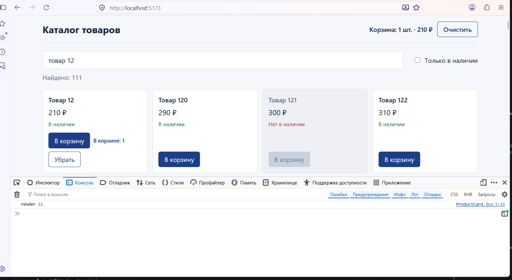

# Каталог товаров: React-хуки

Семинар «Продвинутый React и управление состоянием». Каталог из 5 000 товаров с поиском, фильтром и корзиной.

## Запуск

```bash
npm install
npm run dev
```

## Что в каких коммитах

| Коммит | Хуки | Что сделано |
| --- | --- | --- |
| `step-1` | `useState`, `useMemo`, `useRef`, `useEffect` | поиск без учёта регистра и пробелов, флажок «Только в наличии», «Найдено: N», автофокус |
| `step-2` | `useReducer` | корзина: `add` / `remove` / `clear`, сводка в шапке, кнопки в карточке |
| `step-3` | `memo`, `useCallback`, `useMemo` | один клик «В корзину» → одна строка `render` в консоли |
| `step-4` | `useTransition`, свой хук `useCart` | ввод не тормозит, «Обновляю список…», в `App` нет `useReducer` |
| `extra` | `useEffect` в `useCart` | корзина сохраняется в `localStorage` |

## Структура

```
src/
  data.js            5 000 товаров, создаются один раз вне компонентов
  cartReducer.js     чистый редьюсер корзины
  hooks/useCart.js   пользовательский хук корзины
  App.jsx            состояние страницы, собирает всё вместе
  components/
    Header.jsx       сводка корзины и кнопка «Очистить»
    SearchBar.jsx    поле поиска (автофокус) и флажок
    ProductList.jsx  список
    ProductCard.jsx  карточка (memo)
```

## Проверка шага 3

Откройте консоль браузера, очистите её и нажмите «В корзину» у любого товара. Появляется одна строка `render <id>`.



> Скриншот нужно положить в `screenshots/render.png`.

## Устно: почему без `useCallback` мемоизация карточки не работает?

`memo` сравнивает props поверхностно (`Object.is`). Без `useCallback` функция `onAdd` создаётся заново при каждом рендере `App`, то есть это каждый раз новая ссылка. Для `memo` props изменились, и все 5 000 карточек перерисовываются, хотя данные те же. `useCallback` с пустыми зависимостями (`dispatch` стабилен) возвращает ту же функцию, поэтому пропсы совпадают и карточка пропускает рендер.

По той же причине в карточку передаётся `qty` (число), а не весь `cart`: объект `cart` после каждого `dispatch` новый.
